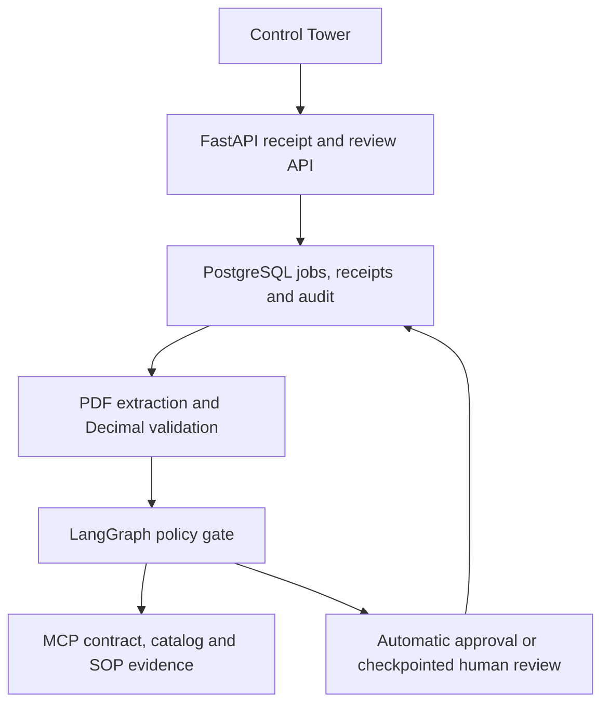

# Autonomous B2B Procurement & Contract Exception Agent

Process purchase order PDFs against approved vendor contracts, catalog prices, and procurement policies. Compliant orders are approved automatically. Exceptions pause for a reviewer with the flagged line, exact financial variance, and policy citation. The Control Tower records approvals, rejections, and copyable dispute drafts.

## Run the evaluator demo

From a checkout with Docker Engine and Compose v2:

```bash
docker compose up
```

Open [the Control Tower](http://127.0.0.1:3000). Upload either bundled PDF from [seed/sample_pdfs](seed/sample_pdfs). The default demo uses exact fixture extraction and local embeddings, so it runs without model credentials. [.env.example](.env.example) lists the optional overrides.

| Scenario | Expected result |
| --- | --- |
| [Clean PO](seed/sample_pdfs/PO-2026-420_Clean.pdf) | `PO-2026-420` for $4,200 is automatically approved. |
| [Apex overcharge](seed/sample_pdfs/PO-2026-419_Apex_Overcharge.pdf) | `PO-2026-419` pauses with a $1,250 overcharge, 20.83% variance, a payment-terms mismatch, and a Finance Director approval requirement. |
| Same PDF again | The queue increments **Duplicate blocked** and retains the original run. |

Use `demo-procurement-reviewer` to draft a dispute or reject an exception. Use `demo-finance-director` to approve the overcharge fixture. Each run accepts one reviewer resolution. Use a fresh demo volume to try a different outcome for the same PDF.

## System design



FastAPI durably records uploads before acknowledging them. SHA-256 deduplication returns the original run. The extraction worker validates structured purchase orders, and the review worker evaluates exact prices and policy thresholds with `Decimal`. PostgreSQL stores both the review checkpoint and its durable audit trail. The Control Tower displays evidence and sends resolutions to the API for role enforcement.

| Component | Responsibility |
| --- | --- |
| `backend/` | FastAPI, durable intake, PDF extraction, LangGraph review, and integration tests |
| `mcp_server/` | FastMCP for exact catalog and contract reads and scoped policy retrieval |
| `frontend/` | Next.js queue, exception inspector, and audit |
| `seed/` | PostgreSQL migrations, demo catalog, policy citations, and sample PDFs |

## Verify and configure

The [verification and demo guide](artifacts/runbooks/verification_and_demo_guide.md) covers the client walkthrough, tests, persistence, result inspection, and provider configuration. See the [system architecture](artifacts/01_system_architecture.md), [decision records](artifacts/02_architecture_decisions.md), and [build spec](SPEC.md) for the design and acceptance criteria.

For the accounts payable extension, use the [QuickBooks Online sandbox setup](artifacts/components/06_qbo_sandbox_setup.md) to provision and verify the two reference purchase orders. The [AP receiving and invoice ledger](artifacts/components/07_ap_receiving_invoice_ledger.md) describes receipt replay, invoice identity, and quantity reservations.
