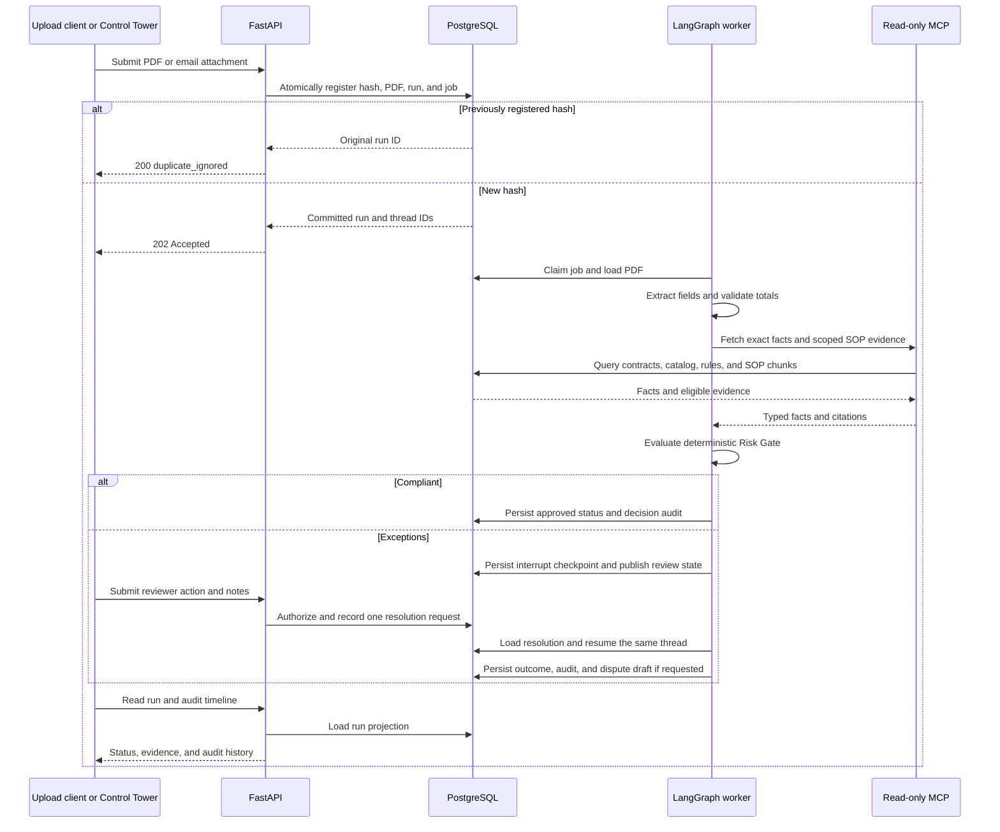
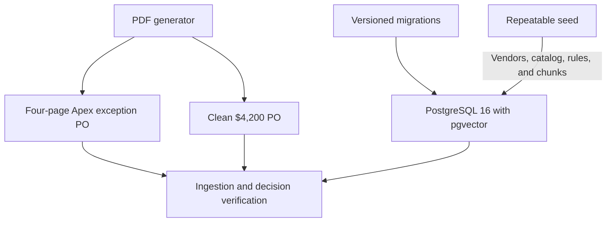
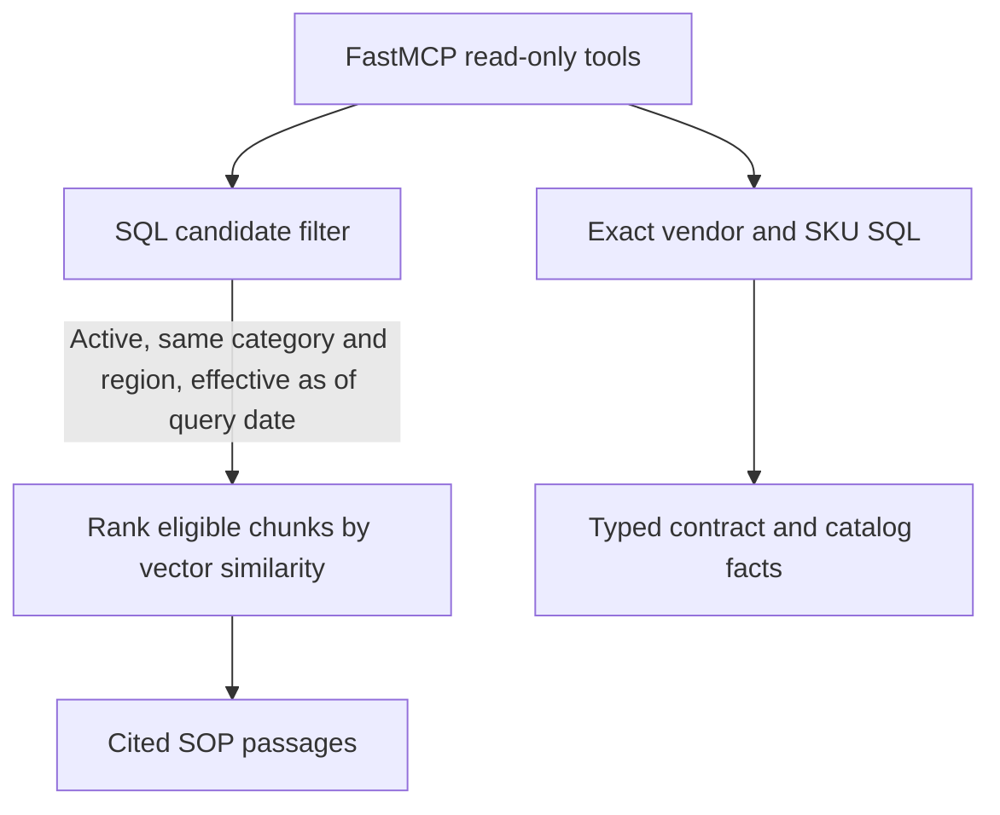
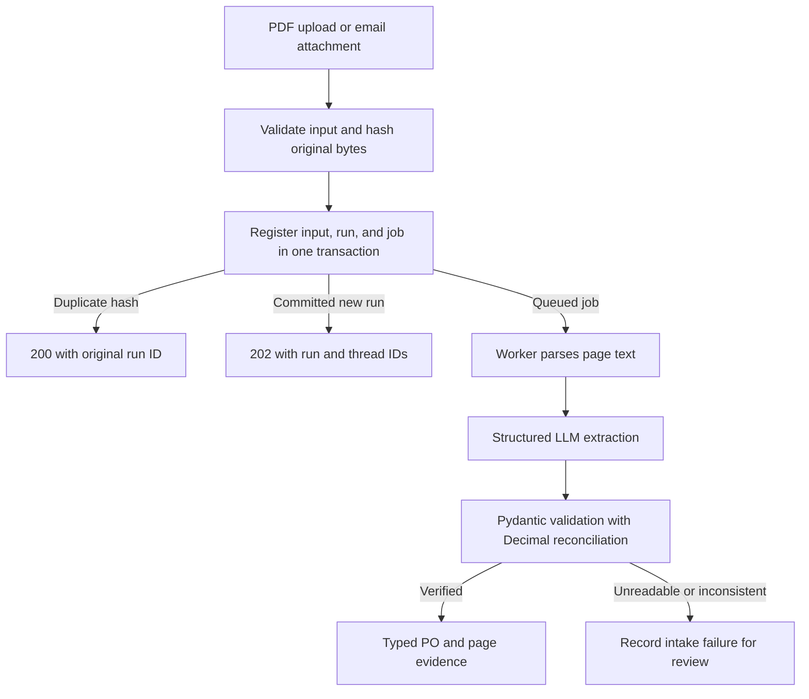
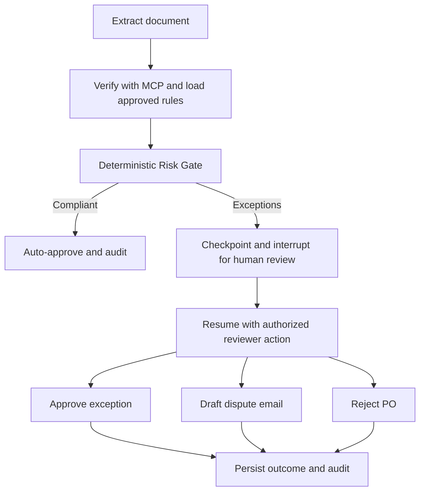
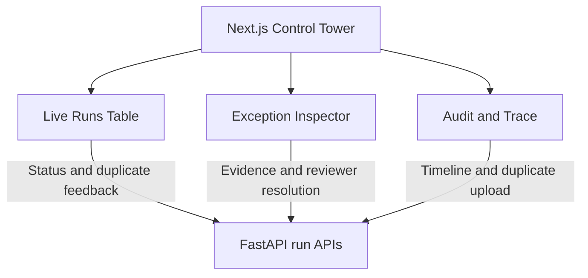
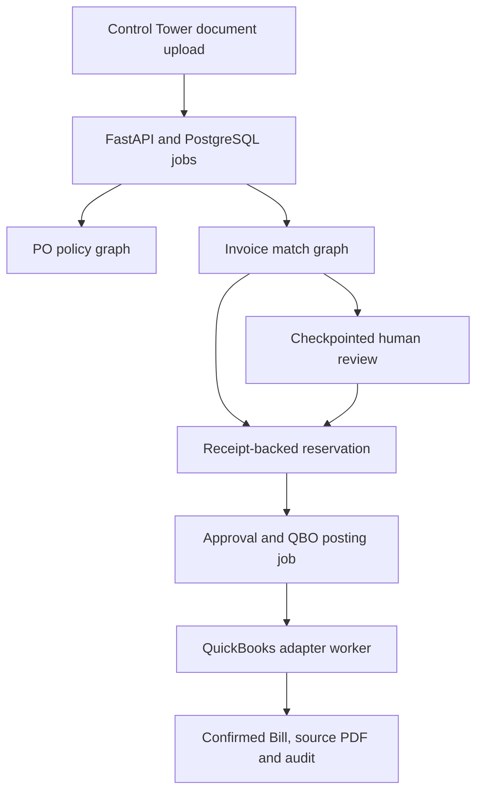

# System architecture

The procurement agent evaluates a purchase order against vendor contract terms, catalog prices, and the applicable procurement policy. A compliant PO receives a recorded approval. Exceptions are routed to a reviewer with the supporting evidence. A dispute resolution produces a draft for the reviewer.

[Business problem statement](00_business_problem_statement.md) · [Build specification](../SPEC.md) · [Architecture decisions](02_architecture_decisions.md)

## End-to-end sequence

## 1. Seed assets and data model

PostgreSQL 16 with pgvector holds input and job state, procurement reference data, SOP rules and evidence, and workflow checkpoints. Versioned migrations own schema changes. A repeatable seed loads stable synthetic vendor, catalog, and policy records. The PDF generator creates independently usable fixtures that reconcile to their printed totals.

| Data owned by PostgreSQL | Contract |
| --- | --- |
| `processed_events` | Unique SHA-256 of original attachment bytes, original `run_id`, source provenance, and receipt time. |
| Run inputs and jobs | Durable PDF reference or bytes. Run-linked jobs track attempts, lease expiry, and retry eligibility. |
| `vendors` and `price_catalog` | Stable vendor identifiers, exact SKU keys, payment terms, currency, units, and decimal amounts. |
| `procurement_runs` and `audit_logs` | Run and thread identifiers, status, verified evidence, reviewer outcome, and timestamped events. LangGraph checkpoints store execution state. |
| SOP rules and `sop_policy_chunks` | Versioned rule values and source passages share policy ID and version. Chunk metadata includes status, effective date, category, region, and source location. |

The Apex exception fixture is `PO-2026-419_Apex_Overcharge.pdf`. Fifty units on line 3 at $145 against the $120 catalog rate produce a $1,250 overcharge and a displayed 20.8% variance. Its $18,450 total and Net-15 terms produce two additional exceptions. The clean fixture is `PO-2026-420_Clean.pdf`. Additional policy fixtures cover archived US, future-effective US, and EU-only rules.

## 2. MCP server and SOP retrieval

The backend calls three explicitly selected FastMCP tools over the application transport. The server uses a read-only database role. The worker derives region and category from trusted run context, with an explicit US procurement scope for the demo. It passes a category on every decision-path call. An omitted category on the tool resolves to the documented procurement default.

| Tool | Output |
| --- | --- |
| `get_vendor_contract_terms(vendor_name: str)` | Canonical vendor identity, payment terms, and applicable contract reference. |
| `get_approved_price_catalog(vendor_name: str, sku_list: list[str])` | Exact matched SKU records with price, currency, unit, and source reference. Missing SKUs are explicit. |
| `search_sop_policy(query: str, category: str \| None = None, region: str = "US")` | Cited passages with policy ID, version, status, effective date, category, region, and source location. |

The SOP tool filters on `status = 'ACTIVE'`, category equality, region equality, and `effective_date <= as_of_date` before ranking. The server uses the UTC evaluation date and records it with the result so decisions can be traced to the policy scope in effect at evaluation. Approved rule values are separate structured records selected by exact SQL and linked to their source policy version. The Risk Gate reads them through the backend data layer, independent of similarity ranking. Missing, ambiguous, or conflicting required evidence blocks auto-approval. If a policy update races the tool and rule lookups, retry evidence collection when the required citations and rule versions disagree.

## 3. Async ingestion and structured extraction

`POST /api/v1/ingest` returns `202` with `run_id` and `thread_id` after a successful commit. A repeat from any supported intake channel returns `200 duplicate_ignored` with the original `run_id`. Events with identical bytes share a run. A regenerated PDF for the same PO falls outside the byte-level identity contract.

The extraction model returns vendor name, PO number, currency, payment terms, line number, SKU, description, quantity, unit price, printed line total, printed grand total, and page references. Represent taxes, freight, and discounts explicitly where present. Use Pydantic v2 with `with_structured_output` and a `@model_validator` to reconcile amounts in Python using documented currency rounding. A worker isolates synchronous PDF parsing from the event loop. Async HTTP uses `httpx.AsyncClient` and bounded tenacity exponential retries for transient `429` and `5xx` responses.

## 4. LangGraph workflow, Risk Gate, review, and tracing

The graph state carries the verified PO, exact match results, policy scope and version, citations, decision inputs, and exception details. Each exception records a code, observed and expected values, a line number when applicable, and evidence references. Compute positive price variance as `(quoted_unit_price - catalog_unit_price) / catalog_unit_price`. Compare the full-precision value with the approved rate before rounding for display. The demo flags price variance strictly above 5%, payment terms that violate an applicable requirement, and totals strictly above $10,000 that require Finance Director approval. Missing, zero, or incompatible catalog amounts produce an exception instead of a percentage.

LangGraph uses a PostgreSQL-backed checkpointer in the worker. The public run enters `AWAITING_REVIEW` when the interrupt checkpoint is available. `POST /api/v1/runs/{run_id}/resolve` accepts `APPROVE`, `DISPUTE`, or `REJECT` plus reviewer notes, with actor identity and authority established server-side. It records one resolution intent and enqueues resume work. The worker resumes the same thread with `Command(resume=...)`. Finance Director exceptions require that authority for approval. A dispute draft uses recorded findings and citations. It is returned to the reviewer for inspection.

The run projection and audit events use guarded transactions with stable event identities. A restart between checkpoint and projection updates triggers reconciliation. Outcome writes can be replayed safely, and a pending resolution remains recoverable until applied. Langfuse tracing is enabled by environment configuration. Keep raw PDFs, credentials, and sensitive commercial fields out of telemetry by default. The local audit log provides the primary decision record.

## 5. Control Tower

The UI reads typed run summaries and detail projections from FastAPI. Its table shows run ID, PO number, vendor, total, status, and duplicate badge. The inspector shows PO lines beside catalog and SOP evidence, highlights flagged rows, and submits reviewer notes with an action. The audit view shows node timestamps, latency, available token cost and trace links, and a duplicate upload action. Missing telemetry displays an unavailable state. The API owns reviewer authorization and state transitions. A conflict response prompts the UI to refresh the run.

## Failure-mode matrix

| Failure | Handling | Verification target |
| --- | --- | --- |
| Concurrent uploads or email forwards of identical bytes | The unique hash and atomic commit yield one run and one job. | Concurrent requests produce one `202` and one or more `200 duplicate_ignored` responses referencing the same run. |
| Service restarts after returning `202` | Durable job remains queued or is reclaimed after lease expiry. | Stop the worker, ingest a PDF, then start the worker and observe the same run complete. |
| PDF is unreadable or amounts fail reconciliation | Record a typed intake failure and retain its evidence. | Invalid fixture receives no auto-approval and exposes an actionable reason. |
| Vendor, SKU, currency, units, or approved policy cannot be resolved safely | Surface missing or incompatible evidence in the run. | An incomplete or mismatched reference blocks auto-approval. |
| Archived, future-effective, or wrong-region SOP has a high vector score | SQL eligibility defines the candidate set before ranking. | Seeded negative controls are excluded for active US procurement searches. |
| Provider returns `429` or `5xx` | Use bounded backoff and record terminal failure when retries are exhausted. | Test retry count, final state, and recovery without duplicate final outcomes. |
| Worker stops between checkpoint and run projection | Reconcile from persisted graph state and make projection writes replay-safe. | Restart around an interrupt and around an outcome write, then check audit uniqueness. |
| Two reviewers resolve the same run | Enforce authorization and one accepted resolution per pending review. | Competing submissions yield one applied action with one decision audit record. |
| Langfuse is unconfigured or unavailable | Continue with PostgreSQL audit history. | The run completes with tracing disabled and the UI renders the local timeline. |

## Component delivery order

Each component closes with its specification and executable verification commands. The component specification records purpose and scope, data contracts, invariants and edge cases, and verification commands.

| Phase | Component and completion check | Specification path |
| --- | --- | --- |
| 1 | Migrations and repeatable seed produce both reconciled PDFs and the policy scope controls. | `artifacts/components/01_seed_and_data_model.md` |
| 2 | MCP returns exact matches and excludes archived, future-effective, and out-of-region SOPs from US procurement retrieval. | `artifacts/components/02_mcp_server_and_rag.md` |
| 3 | Concurrent intake establishes one durable run. Structured extraction reconciles multi-page PO totals. | `artifacts/components/03_ingestion_and_pydantic.md` |
| 4 | Clean POs are approved. Exception runs survive a restart, resume, and produce one audited outcome. | `artifacts/components/04_langgraph_hitl_and_tracing.md` |
| 5 | The Control Tower reads runs, shows cited exceptions, and submits reviewer actions. | `artifacts/components/05_frontend_control_tower.md` |
| 6 | A Compose startup supports the end-to-end verification and client demo. | `artifacts/runbooks/verification_and_demo_guide.md` |

## Accounts payable extension

Invoice metadata routes durable uploads to the invoice graph. The [AP workflow component](components/10_ap_workflow_and_control_tower.md) defines the checkpoint and posting handoff. The receiving ledger supplies exact commercial facts, while the existing MCP tools continue to serve PO review. A separate posting worker consumes approved invoice jobs and publishes sync completion after Bill and PDF confirmation.

