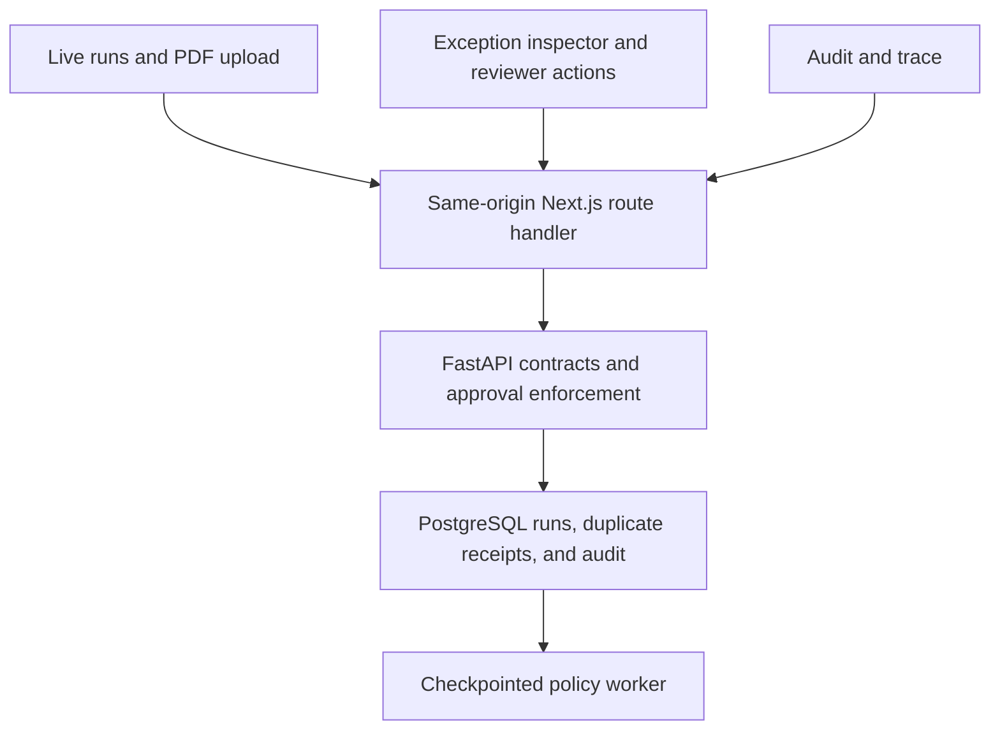

# Procurement Control Tower

## Scope and architecture

The Control Tower is a dark-mode Next.js App Router application built with TypeScript and Tailwind. It displays the queue and lets an authenticated reviewer inspect a flagged order, apply a resolution, and follow the resulting audit trail.



- `frontend/components/control-tower.tsx` loads the latest 50 runs, polls the selected run, handles file upload, and shows API outcomes. The queue displays the PO number, run ID, vendor, grand total, status, and duplicate count. A run ID is abbreviated in the queue and shown in full in the inspector.
- `frontend/components/inspector.tsx` puts extracted lines and observed/expected findings side by side. A finding tied to a line highlights that row. Policy excerpts expand from their citations. The reviewer submits notes and a bearer token with **Approve Exception**, **Draft Dispute Email**, or **Reject PO**. A submitted action stays pending until the worker projects its result.
- `frontend/components/audit.tsx` displays persisted lifecycle events and checkpointed node timestamps and latencies. When configured, the run links to the deterministic Langfuse trace. **Test Duplicate Upload** verifies the selected run's original receipt and exercises the same duplicate counter as a repeat PDF upload.
- `frontend/app/api/procurement/[...path]/route.ts` allows only the required paths and forwards them to `PROCUREMENT_API_URL`. PDF requests stream to FastAPI and preserve the existing size checks. The reviewer bearer token is held in the browser form for the current action and forwarded only to the resolution route.

## API contracts and invariants

| Endpoint | Behavior |
| --- | --- |
| `GET /api/v1/runs?limit=50` | Newest-first summaries. Accepts 1–100 rows. Queue filters and counts apply to the loaded window. |
| `GET /api/v1/runs/{run_id}` | Returns the extracted PO, findings, duplicate count, checkpointed node timings, applied resolution, and optional dispute draft and trace URL. |
| `POST /api/v1/ingest` | Uploads an actual PDF. The prior `202`/duplicate `200` contract remains in effect. |
| `POST /api/v1/runs/{run_id}/test-duplicate` | Checks the original saved bytes against their receipt hash and increments the duplicate count on a match. It has no path to create a new run or job. |
| `POST /api/v1/runs/{run_id}/resolve` | Reuses Phase 4 authentication and approval enforcement. Pending intent and terminal outcome are separate states. |
| `GET /api/v1/runs/{run_id}/audit` | Returns chronological workflow lifecycle events with actor and timestamp where available. |

The underlying state remains `AWAITING_REVIEW`. The UI displays “Awaiting approval.” Amounts stay decimal strings and are formatted without conversion to a JavaScript floating-point number. The API and review worker remain authoritative for action acceptance, role checks, and approval decisions. The Next.js application assumes the same trusted internal deployment boundary as FastAPI for run reads, PDF upload, and receipt testing. The same-origin proxy is a routing boundary. User and network access control still belong to the deployment.

Migration 005 initializes existing receipts at zero. Only new duplicate events contribute to the count. Existing completed runs may lack node timings. The recorded latency excludes reviewer wait time. If Langfuse keys and project ID are configured, the link uses the run ID's deterministic trace ID. The UI displays unavailable telemetry when the link is absent and does not estimate token cost.

## Verification

Start the database and backend services using the [Phase 4 runbook](04_langgraph_hitl_and_tracing.md). Set distinct API reviewer tokens and configure the MCP reader role. Then start the Control Tower:

```bash
cd frontend
npm ci
npm run typecheck
npm run build
PROCUREMENT_API_URL=http://127.0.0.1:8000 npm run start
```

Open `http://127.0.0.1:3000`. Upload the clean and overcharge PDFs in `seed/sample_pdfs/`. Confirm the clean PO is approved, the excess-price line is red, policy references open, the duplicate action keeps the original run, and the selected review action appears in the audit timeline after the worker resumes.

For CI, `control-tower.yml` provisions PostgreSQL, starts FastAPI, FastMCP, and the review worker, and runs Playwright in Chromium. It uses a test-only extraction worker for the two seeded documents, so model credentials are unnecessary. The browser checks clean approval, the three cited exceptions, node timing visibility, unchanged run count after a duplicate, Finance Director enforcement, a dispute email draft, and mobile viewport width. The backend test suite covers the other reviewer actions and failure paths.
