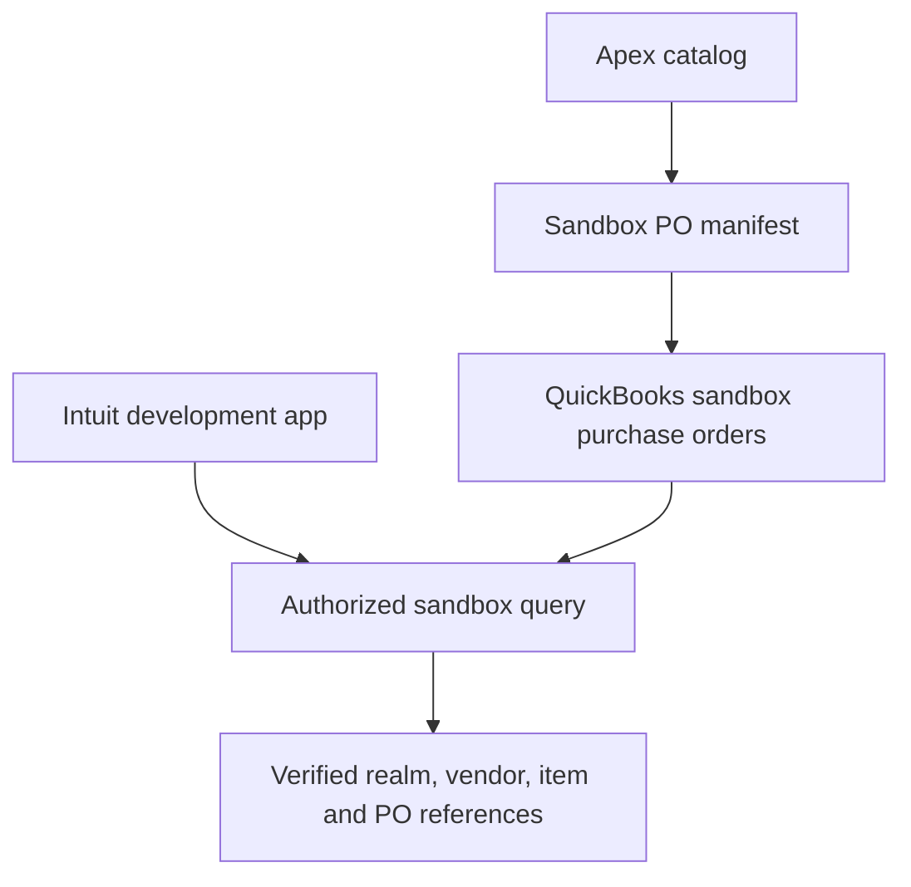

# QuickBooks Online Sandbox and Reference Purchase Orders

## Purpose & Scope

Provision a US QuickBooks Online Plus sandbox and two open Apex Industrial Supply purchase orders for AP three-way matching. The seed manifest supplies catalog-backed values for operators. Intuit handles development authorization and the initial read-back. The application OAuth callback and QBO adapter are scheduled for a later phase.



## Data Contracts / Schemas

| Setting | Source |
| --- | --- |
| `QBO_CLIENT_ID` | Intuit app development credentials |
| `QBO_CLIENT_SECRET` | Intuit app development credentials |
| `QBO_REDIRECT_URI` | Exact URI registered under Development credentials. Proposed local app callback is `http://localhost:8000/api/v1/qbo/oauth/callback`. |
| `QBO_REALM_ID` | Company ID returned when authorizing the selected US sandbox |

Use the scope `com.intuit.quickbooks.accounting`. Store credentials in an ignored local `.env` or secret manager. The proposed application callback becomes usable when the adapter is implemented. Use the redirect URI specified by Intuit's OAuth playground for the initial verification and register it if the playground requires it.

Both POs use Apex Industrial Supply, USD, and Apex Net 30 vendor terms. Enter item lines using the manifest SKUs, quantities and costs.

| PO | Ordered goods | Total | Later AP fixture |
| --- | --- | --- | --- |
| `AP-DEMO-001` | 20 SS-316 Valve at $120, 10 GSK-150 at $40, 20 CLP-316 at $70 | $4,200 | Fully received. One matching $4,200 invoice. |
| `AP-DEMO-002` | 50 SS-316 Valve at $120, 10 ACT-24V at $340 | $9,400 | Receive 20 valves and invoice 20. Receive another 10 valves. A subsequent invoice for 15 valves exceeds the remaining received quantity by 5. Use a separate invoice variant to exercise price and freight exceptions. |

## Invariants & Edge Cases

- Use a US sandbox with purchase orders enabled. Confirm the sandbox company at consent and read-back.
- Find each PO by its document number before creating it. If the company assigns a different number, record the actual document number alongside its scenario and QBO ID for downstream matching. Keep both POs open and omit tax and freight in the PO fixtures.
- Each PO line references a QBO item. Match item identity through the item ID and its SKU, and retain the QBO PO and line IDs for later sync. Verify rates against the manifest because the UI may fill prices from the sandbox item record.

## Verification Commands

From the repository root, run:

```bash
python -m seed.qbo_sandbox
python -m pytest -q seed/tests/test_qbo_sandbox.py
```

Then verify in Intuit:

1. Open the app's development credentials and the US sandbox. Enable purchase orders in the sandbox's expense settings.
2. Find or create the Apex vendor and the four manifest items, then save both purchase orders from the manifest using item lines.
3. Authorize the development app against that sandbox through Intuit's OAuth playground. Use the resulting sandbox authorization in the QBO API Explorer to query the company. Keep keys, authorization codes, and tokens out of shared output.

```sql
SELECT * FROM PurchaseOrder WHERE DocNumber = 'AP-DEMO-001'
SELECT * FROM PurchaseOrder WHERE DocNumber = 'AP-DEMO-002'
```

Run each query separately. Substitute the actual document numbers if the sandbox assigned its own. Verify exactly one open record per fixture, matching vendor, quantities, rates and total. Capture the sandbox realm ID, PO IDs and item IDs for the next phase. Inspect line IDs on the returned POs.

Intuit references: [Development credentials](https://developer.intuit.com/app/developer/qbo/docs/get-started/get-client-id-and-client-secret), [OAuth 2.0 setup](https://developer.intuit.com/app/developer/qbo/docs/develop/authentication-and-authorization/oauth-2.0), [purchase order setup](https://quickbooks.intuit.com/learn-support/en-us/help-article/purchase-orders/create-send-purchase-orders-quickbooks-online/L2mVpjOoq_US_en_US).
